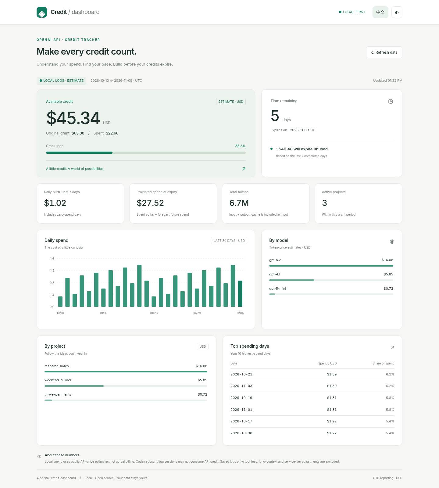
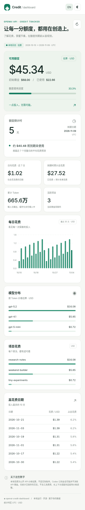

# openai-credit-dashboard

Make every credit count. A private, local dashboard for your OpenAI API gift credit: spending, remaining credit, daily burn, and a forecast before expiry. Built with **Python 3.9+ standard library only** and plain HTML/CSS/JavaScript. No pip packages, frontend build, CDN, or telemetry.

[简体中文](README.zh-CN.md) · [MIT license](LICENSE)



<details><summary>Mobile preview</summary>



</details>

## Quick start

```bash
python3 server.py --port 8765 --mode local
```

Open **http://127.0.0.1:8765/**. Stop with Ctrl+C. The default interface is Chinese; use **EN** to switch to English and **◐** for dark mode. These preferences stay in your browser. With no logs, the dashboard shows a zero-spend empty state.

Set your grant details explicitly for meaningful results:

```bash
cp config.example.json config.json
# Edit config.json: grant_total, grant_start, expiry
python3 server.py --port 8765
```

Or use flags:

```bash
python3 server.py --mode local --grant-total 68 \
  --grant-start 2026-10-10 --expiry 2026-11-09
python3 server.py --mode local --json
```

Without configuration, the grant is $200, starts on the first day of the current UTC month, and expires 30 days from today. Those are convenience defaults, **not account information**. The grant amount and dates are user supplied; this tool does not fetch your actual gift-credit balance or expiry.

To explore synthetic data without reading your real sessions:

```bash
python3 server.py --config examples/demo.config.json --port 8765
```

The screenshots use this example's October–November 2026 period. Its countdown changes with the real date.

## Data modes

### Official

Create an [organization Admin key](https://platform.openai.com/settings/organization/admin-keys), then put it in an environment variable or the repository's `.env`:

```bash
cp .env.example .env
# Edit .env locally: OPENAI_ADMIN_KEY=...
python3 server.py --mode official
```

The server makes read-only GET requests to:

- [`/v1/organization/costs`](https://developers.openai.com/api/reference/resources/admin/subresources/organization/subresources/usage/methods/costs): daily buckets grouped by `line_item` and `project_id`. These amounts determine total, daily, and project spend.
- [`/v1/organization/usage/completions`](https://developers.openai.com/api/reference/resources/admin/subresources/organization/subresources/usage/methods/completions): daily buckets grouped by `model` and `project_id`. Token counts and editable prices provide the **estimated** model breakdown. It may not reconcile with billed costs, which can include non-completion products.

Both use Unix `start_time`/`end_time`, `bucket_width=1d`, `limit=31`, and follow `next_page` while `has_more` is true. A 401 or 403 displays: **“key lacks admin permission; create an Admin key at platform.openai.com/settings/organization/admin-keys”**. Other API/network errors are reported without exposing response bodies. Official failures never silently fall back to estimates.

Organization costs can lag and include charges beyond your gift grant. Remaining credit is `configured grant − costs in the configured period`, not an authoritative billing balance. Multiple grants, purchased credit, and grant allocation rules are not reconciled.

### Local

Reads `~/.codex/sessions/**/*.jsonl` without modifying files. It extracts only usage counters, dates, model, and project from session metadata/turn context. Project names are the session working directory's basename. Repeated cumulative counters are ignored; deltas are used after the first response. The first/reset event uses `last_token_usage` when available, avoiding inherited fork totals. Last-only events are supported. Output already includes reasoning tokens; reasoning is not charged twice. Same-named session-file copies are read once. Unusual forks, last-only repeated events, incomplete histories, and other duplicated imports can still affect accuracy. Archived/compressed files are outside this version's scope.

Add an optional usage log with `--log-file /path/to/usage.jsonl`:

```json
{"ts":"2026-11-04T10:00:00Z","model":"gpt-5.2","input_tokens":10000,"cached_input_tokens":2000,"output_tokens":800,"project":"my-app"}
```

`ts` accepts ISO 8601 or Unix seconds (timezone-free timestamps mean UTC). Cached input is a subset of input. Do not include the same usage in Codex sessions and the optional log; these sources are additive. Malformed lines are skipped with a warning.

**All local costs are estimates. Codex subscription activity may not consume API gift credit at all.** Saved logs do not cover all API activity or tool charges. Use official mode for organization billing.

### Auto (default)

Uses official mode when `OPENAI_ADMIN_KEY` is nonempty; otherwise uses local mode. You can explicitly select either mode with `--mode`.

## Configuration and pricing

Precedence: **CLI flags > `CREDIT_` environment variables > config JSON > defaults**. Existing process environment variables take precedence over `.env` values. `.env` is read from the repository root and supports literal `KEY=value` and quoted values; it never executes shell code or expands variables.

| JSON setting | CLI flag | Environment variable |
| --- | --- | --- |
| `grant_total` | `--grant-total` | `CREDIT_GRANT_TOTAL` |
| `grant_start` | `--grant-start` | `CREDIT_GRANT_START` |
| `expiry` | `--expiry` | `CREDIT_EXPIRY` |
| `mode` | `--mode` | `CREDIT_MODE` |
| `sessions_dir` | `--sessions-dir` | `CREDIT_SESSIONS_DIR` |
| `log_file` | `--log-file` | `CREDIT_LOG_FILE` |
| `pricing_file` | `--pricing-file` | `CREDIT_PRICING_FILE` |
| `port` | `--port` | `CREDIT_PORT` |

Choose a different config with `--config PATH`. Dates use `YYYY-MM-DD`. File paths in configuration/flags are relative to the launching directory; `~` expands to your home directory. Secrets belong only in the environment/`.env`, never config JSON or command arguments.

Edit [pricing.json](pricing.json) to set USD rates **per 1 million tokens** (`input`, `cached_input`, `output`). It includes GPT-5.x/Codex, GPT-4.1, o-series, mini/nano and selected newer models. These are editable baseline standard text prices, not a live feed; verify against [official OpenAI pricing](https://developers.openai.com/api/docs/pricing) and individual model pages. Cache writes, long-context premiums, tools, service tiers, discounts and regional adjustments are not modeled. Dated model snapshots use their base model's prices. Unknown variants use `default` and are visibly listed in the dashboard/API; they are never silently matched to a similar model.

Cost = `((input − cached) × input_rate + cached × cached_rate + output × output_rate) / 1,000,000`. Cached tokens are clamped to the input count.

## Forecast rules

- All daily buckets use **UTC**. The grant interval is **[grant_start, expiry)**: expiry is midnight UTC at the start of that date. Set the next date if you want to include an entire final day.
- Spent is all recorded costs within that interval up to now. Remaining is clamped at zero; percent used may exceed 100%.
- Daily burn averages the seven completed UTC days before today (or expiry for an expired grant), including zero days. For new grants, only completed days since grant start count. Today's partial spend is excluded from burn but included in spent.
- Projected spend is spent plus burn × time left. The remaining fraction of today is included. If the grant can be exhausted before expiry, the UI says “will use it up by X”; otherwise “~$Y will expire unused”. At expiry it reports the estimated unused amount. With no completed-day data, burn is zero.

The chart shows the last 30 recorded calendar days in the grant interval, including zero days. `/api/summary` and the JSON CLI include the full daily history, model/project/line-item breakdowns, tokens, top 10 days, fallback models, and warnings. The server caches successful summaries for 30 seconds; the UI polls every minute. Refresh may reuse that short cache.

## Privacy

The server binds **127.0.0.1 only**. Local mode sends nothing over the network. Official mode sends the Admin key only to **https://api.openai.com**, rejects redirects, and never logs request headers, API errors, or keys. Keys are never returned to the browser. Static serving uses a strict allowlist: `.env`, config, source code, and logs cannot be downloaded. Host checks and cross-site request checks protect the local endpoint; no CORS access is enabled.

The browser receives aggregates with model/project names and usage totals, not session paths or conversation content. No external scripts, fonts, analytics, or chart libraries load. `.env`, private config, and common local log names are gitignored; keep custom usage logs outside the repository. Browser language/theme preferences use localStorage. The local HTTP service has no login: other software/users on the same machine may access it.

## Codex skill

The repository contains [skills/openai-credit-dashboard/SKILL.md](skills/openai-credit-dashboard/SKILL.md). On macOS/Linux, install it by linking the skill directory (keep the checkout available):

```bash
mkdir -p ~/.codex/skills
ln -s "$PWD/skills/openai-credit-dashboard" ~/.codex/skills/openai-credit-dashboard
```

Then invoke `$openai-credit-dashboard` in Codex. The skill starts/reuses this Python server, checks its health and summary, and returns its local URL. It needs no runtime download. On Windows, use a directory symlink/junction or invoke the skill from the checkout; copying only SKILL.md loses its link to server.py.

## Development

```bash
python3 -m unittest
python3 -m compileall -q dashboard.py server.py
```

Tests use synthetic fixtures and mocked urllib responses; no real API key or network access is required. Runtime is entirely stdlib. Frontend source lives in `static/`; charts are hand-written SVG, with no build step. Contributions are welcome: keep dependencies at zero and add focused unittest coverage for accounting or parser changes. Never commit private logs or credentials.

## Inspiration and license

Inspired by [luyh7/codex-usage-dashboard](https://github.com/luyh7/codex-usage-dashboard) (MIT), particularly its local-first dashboard and launcher-skill structure. Its README and skill documentation were consulted for structure ideas only; no source code was copied.

[MIT](LICENSE) · Copyright (c) 2026 Galen Xu. This is an independent community project, not an OpenAI product.
