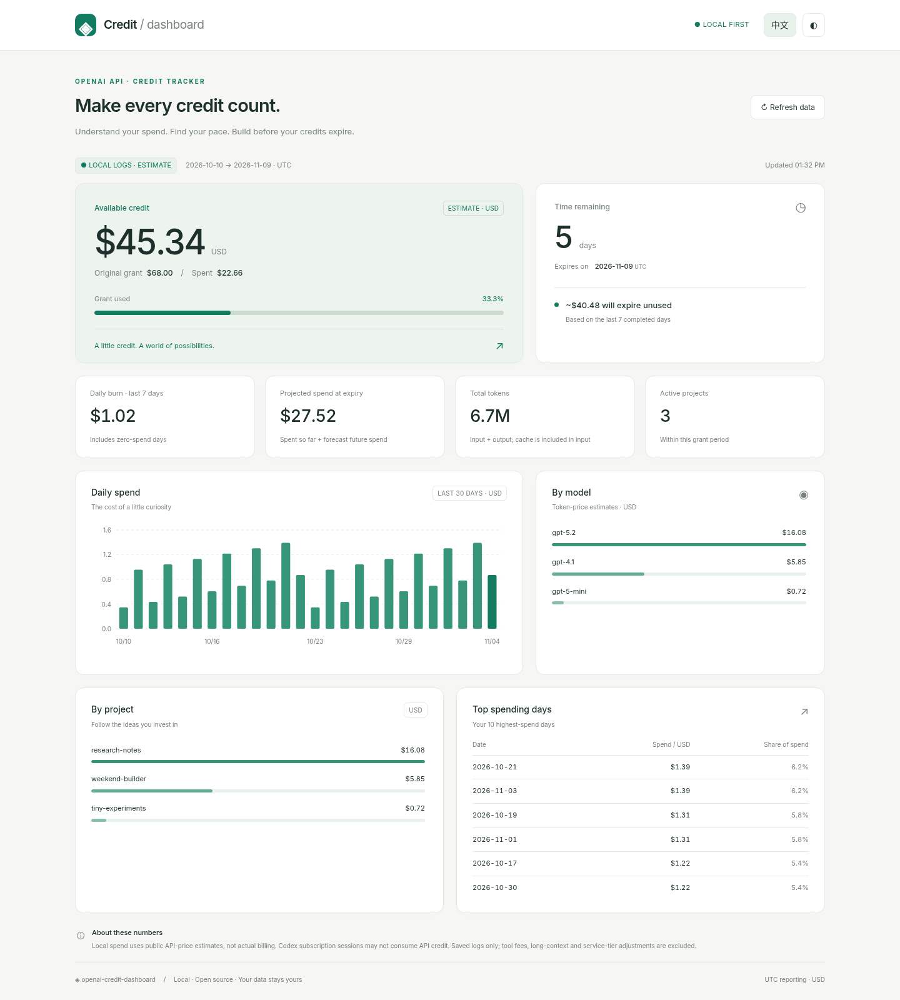
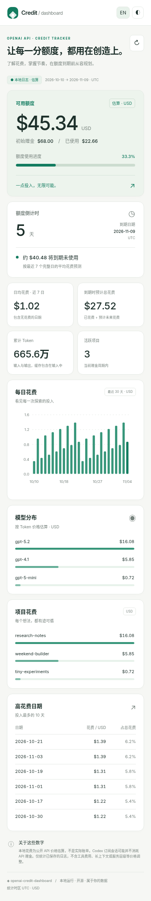

# openai-credit-dashboard

让每一分额度，都用在创造上。一个在本机运行的 OpenAI API 赠金额度看板：查看花费、剩余额度、每日消耗与到期预测。**仅依赖 Python 3.9+ 标准库**，前端使用原生 HTML/CSS/JavaScript，无需 pip、构建步骤或 CDN。

[English](README.md) · [MIT 许可证](LICENSE)



<details><summary>手机预览</summary>



</details>

## 快速开始

```bash
python3 server.py --port 8765 --mode local
```

打开 **http://127.0.0.1:8765/**，按 Ctrl+C 停止。默认简体中文，点击 **EN** 切换英语，点击 **◐** 切换明暗主题。偏好仅保存在浏览器。没有日志时展示零花费状态。

配置自己的额度与日期：

```bash
cp config.example.json config.json
# 编辑 config.json 中的 grant_total、grant_start、expiry
python3 server.py --port 8765
```

也可直接传入参数：

```bash
python3 server.py --mode local --grant-total 68 \
  --grant-start 2026-10-10 --expiry 2026-11-09
python3 server.py --mode local --json
```

默认额度为 $200，起始日为当前 UTC 月第一天，到期日为今天之后第 30 天。这些只是启动默认值，**不是你的账户信息**。金额与日期需要手动设置；本项目不查询真实赠金余额或有效期。

使用合成示例数据，不读取真实会话：

```bash
python3 server.py --config examples/demo.config.json --port 8765
```

截图使用示例的 2026 年 10–11 月数据。倒计时随实际日期变化。

## 两种数据来源

### 官方模式

在 [OpenAI 平台](https://platform.openai.com/settings/organization/admin-keys)创建组织 Admin key，写入环境变量或仓库根目录的 `.env`：

```bash
cp .env.example .env
# 在本地编辑 .env，设置 OPENAI_ADMIN_KEY=...
python3 server.py --mode official
```

后端只发送 GET 请求：

- [`/v1/organization/costs`](https://developers.openai.com/api/reference/resources/admin/subresources/organization/subresources/usage/methods/costs)：按天、`line_item` 和 `project_id` 分组，用于总花费、每日花费与项目花费。
- [`/v1/organization/usage/completions`](https://developers.openai.com/api/reference/resources/admin/subresources/organization/subresources/usage/methods/completions)：按天、`model` 和 `project_id` 分组。模型花费由 Token 与价格表**估算**，可能与包含其他产品费用的官方账单不同。

两个接口均传 Unix `start_time`/`end_time`、`bucket_width=1d`、`limit=31`；当 `has_more` 为真时，通过 `next_page` 继续翻页。401/403 会显示明确提示：**“key lacks admin permission; create an Admin key at platform.openai.com/settings/organization/admin-keys”**。其他错误也会显示安全提示，不暴露上游响应内容。官方模式失败不会悄悄降级成本地估算。

官方花费可能延迟，也可能包含不由赠金支付的费用。看板余额是“设置的额度 − 所设期间内的组织花费”，不等于实际账单余额；暂不处理多笔赠金、充值余额或赠金抵扣规则。

### 本地模式

只读扫描 `~/.codex/sessions/**/*.jsonl`，提取使用量计数、日期、模型与项目。模型来自 `turn_context` 或 `session_meta`，项目是会话 cwd 的目录名。

优先计算累计 Token 的增量，忽略相同计数的重复快照。首条或计数重置后的事件优先用 `last_token_usage`，避免直接计入 fork 继承的累计历史；也兼容只有 last 的事件。推理 Token 已包含在输出中，不重复计费。同名会话文件副本只读一次。特殊 fork、重复的 last-only 事件、不完整历史或重复导入仍可能影响精度。暂不读取压缩或归档会话。

可用 `--log-file /path/to/usage.jsonl` 追加自己的记录：

```json
{"ts":"2026-11-04T10:00:00Z","model":"gpt-5.2","input_tokens":10000,"cached_input_tokens":2000,"output_tokens":800,"project":"my-app"}
```

`ts` 支持 ISO 8601 或 Unix 秒数；无时区时间按 UTC 处理。缓存输入是输入总量的子集。两个来源会相加，请勿重复记录相同请求。格式损坏的行会跳过，并提示警告。

**本地花费全部是 API 价格估算，不是真实账单。Codex 订阅会话可能并不消耗 API 赠金。** 已保存日志不覆盖全部 API 活动，也不包含工具费用。查看组织账单请用官方模式。

### 自动模式（默认）

存在非空 `OPENAI_ADMIN_KEY` 时使用官方模式，否则使用本地模式；可通过 `--mode` 显式选择。

## 配置与价格

优先级：**CLI 参数 > `CREDIT_` 环境变量 > config JSON > 默认值**。已有进程环境变量优先于 `.env`。`.env` 从仓库根目录读取，只解析字面量 `KEY=value` 与引号，不执行命令或展开变量。

| JSON 字段 | CLI 参数 | 环境变量 |
| --- | --- | --- |
| `grant_total` | `--grant-total` | `CREDIT_GRANT_TOTAL` |
| `grant_start` | `--grant-start` | `CREDIT_GRANT_START` |
| `expiry` | `--expiry` | `CREDIT_EXPIRY` |
| `mode` | `--mode` | `CREDIT_MODE` |
| `sessions_dir` | `--sessions-dir` | `CREDIT_SESSIONS_DIR` |
| `log_file` | `--log-file` | `CREDIT_LOG_FILE` |
| `pricing_file` | `--pricing-file` | `CREDIT_PRICING_FILE` |
| `port` | `--port` | `CREDIT_PORT` |

用 `--config PATH` 指定其他配置。日期使用 `YYYY-MM-DD`。路径相对于启动目录，`~` 会展开为用户目录。密钥仅写入环境变量或 `.env`，不要放入配置或命令行参数。

可编辑 [pricing.json](pricing.json)，单位为**美元 / 百万 Token**，字段为 `input`、`cached_input`、`output`。内置 GPT-5.x/Codex、GPT-4.1、o 系列、mini/nano 及部分更新模型的标准文本价格基准；这不是实时价格源，请按[官方价格](https://developers.openai.com/api/docs/pricing)及模型页面核对。暂不处理长上下文、缓存写入、工具、服务层级、区域差价与折扣。带日期后缀的快照使用基础模型价格；其他未知变体走 `default`，并在页面和 JSON 中明确列出。

估算公式：`((输入 − 缓存) × 输入单价 + 缓存 × 缓存单价 + 输出 × 输出单价) / 1,000,000`。缓存数量最多按输入总量计算。

## 预测规则

- 统一按 **UTC** 统计，赠金区间为 **[grant_start, expiry)**，到期日从当天 UTC 零点起不计入。若要包含最后一整天，请将 expiry 设为次日。
- 已花费只计算所设区间截至现在的记录；剩余最小为 0，使用百分比可超过 100%。
- 日均消耗取今天（已到期时取到期日）之前的 7 个完整 UTC 日，包含零花费日。新赠金仅使用起始日后的完整日期。今天的部分数据计入已花费，不计入日均。
- 预计总花费 = 已花费 + 日均 × 剩余时间，含今天剩余的小数天。能在到期前用完则显示日期，否则显示预计到期未用金额。已到期时显示未用金额。没有完整日数据时日均为 0。

图表展示赠金期间最近 30 个已发生的日历日，含零花费日。`/api/summary` 和 `--json` 包含完整每日历史、模型/项目/账单项分布、Token、前 10 高花费日、默认价格模型与警告。后端缓存成功结果 30 秒，页面每分钟轮询；手动刷新也可能复用这段短缓存。

## 隐私

服务仅绑定 **127.0.0.1**。本地模式不发送网络请求；官方模式仅向 **https://api.openai.com** 发送密钥，并拒绝重定向。请求头、上游响应与密钥不记录、不返回浏览器。静态文件使用固定白名单，不能下载 `.env`、配置、源码或日志。Host 和跨站请求检查保护本机接口，不开放 CORS。

浏览器仅获取带模型/项目名的汇总使用量，不获取会话路径或对话内容。没有外部脚本、字体、分析服务或图表库。`.env`、私有配置和常见日志名已加入 gitignore；自定义日志请放在仓库外。语言和主题偏好存在浏览器 localStorage。本机 HTTP 服务没有登录验证，同一机器的其他程序或用户可能访问。

## Codex Skill

仓库附带 [skills/openai-credit-dashboard/SKILL.md](skills/openai-credit-dashboard/SKILL.md)。macOS/Linux 可创建符号链接，保留仓库路径：

```bash
mkdir -p ~/.codex/skills
ln -s "$PWD/skills/openai-credit-dashboard" ~/.codex/skills/openai-credit-dashboard
```

在 Codex 中调用 `$openai-credit-dashboard`。Skill 启动或复用 Python 服务，检查健康状态与汇总结果后提供本地 URL，无需下载运行时。Windows 可用目录符号链接/junction，或直接从仓库调用；仅复制 SKILL.md 无法定位 server.py。

## 开发

```bash
python3 -m unittest
python3 -m compileall -q dashboard.py server.py
```

测试使用合成 fixture 和模拟 urllib 响应，不需要真实密钥或联网。运行时完全使用标准库，前端在 `static/` 中，图表为手写 SVG。欢迎贡献，请保持零依赖，并为计费或解析逻辑增加有意义的 unittest。不要提交私人日志或凭据。

## 灵感与许可

结构灵感来自 [luyh7/codex-usage-dashboard](https://github.com/luyh7/codex-usage-dashboard)（MIT），尤其是本地看板与启动 Skill。仅阅读其 README 与 Skill 文档作为结构参考，没有复制源码。

[MIT](LICENSE) · Copyright (c) 2026 Galen Xu。本项目为独立社区项目，非 OpenAI 官方产品。
